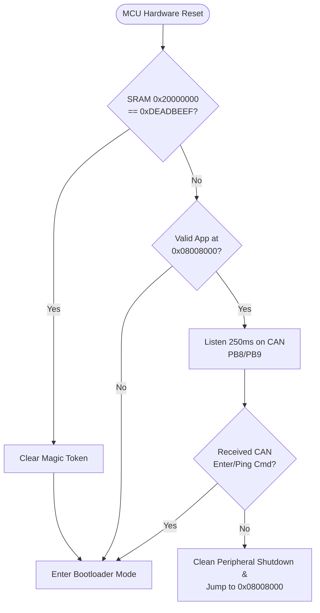

# BFR STM32U535 DAQ CAN Bootloader

Dedicated CAN Bootloader for the **Bruin Formula Racing (UCLA Formula SAE)** Mk. 12 DAQ network.

## Hardware & Architecture

* **MCU**: STM32U535CCT6 (ARM Cortex-M33 with FPU, LQFP48, 256 KB Flash, 272 KB SRAM)
* **CAN Hardware**: Bosch M_CAN (FDCAN1)
  * **RX**: `PB8` (Alternate Function AF9)
  * **TX**: `PB9` (Alternate Function AF9)
* **Status LED**: `PB7`
  * Drives base of `Q4` (MMBT3904) through $R_{44} = 100\text{ k}\Omega$, sinking Red LED `D18` to ground.
  * `PB7 = HIGH` $\rightarrow$ LED ON
  * `PB7 = LOW` $\rightarrow$ LED OFF
  * **5 Hz Blink**: Waiting in Bootloader mode
  * **Rapid Toggle**: Actively writing flash memory
  * **OFF**: Bootloader handing over execution to application

## Memory Map

| Section | Start Address | End Address | Size | Allocation |
| :--- | :--- | :--- | :--- | :--- |
| **Bootloader** | `0x08000000` | `0x08007FFF` | 32 KB (Pages 0–3) | Protected bootloader code (Never erased over CAN) |
| **Application** | `0x08008000` | `0x0803FFFF` | 224 KB (Pages 4–31) | Board user firmware |
| **SRAM Base** | `0x20000000` | `0x20000003` | 4 Bytes | Magic Token location (`0xDEADBEEF`) |

## Boot Decision Flow



## Protocol Specifications

* **Nominal Bitrate**: 1 Mbps (Arbitration phase)
* **Data Bitrate**: 2 Mbps / 5 Mbps (CAN-FD BRS phase)
* **Dual-Mode Compatibility**: Bosch M_CAN natively accepts both Classic CAN 2.0B frames (DLC $\le$ 8) and CAN-FD frames (DLC $\le$ 64). The bootloader mirrors the host's framing mode on responses.

### Command Opcodes

| Command | Opcode | Description |
| :--- | :--- | :--- |
| `CMD_ENTER_BOOTLOADER` | `0x01` | Commands MCU to enter bootloader mode |
| `CMD_PING` | `0x02` | Queries node presence, operating mode, and firmware version |
| `CMD_ERASE_APP` | `0x03` | Unlocks flash and erases application pages (Pages 4–31) |
| `CMD_WRITE_DATA` | `0x04` | Programs 128-bit (16-byte) quad-words to flash |
| `CMD_VERIFY` | `0x05` | Computes IEEE 802.3 CRC32 over flashed image and compares |
| `CMD_ACK` | `0x06` | Success response |
| `CMD_JUMP_APP` | `0x07` | Validates app, cleans peripherals, sets VTOR, jumps to app |
| `CMD_MODE_NEGOTIATE` | `0x08` | Negotiates CAN-FD and max block transfer payload |
| `CMD_NACK` | `0x15` | Error response |

## Building the Bootloader

The Makefile automatically discovers the native ARM GNU Toolchain installed on your system or inside STM32CubeIDE:

```bash
cd Bootloader
make clean
make
```

Output binaries will be placed in `Bootloader/build/`:
* `bootloader.elf`
* `bootloader.bin`
* `bootloader.hex`
