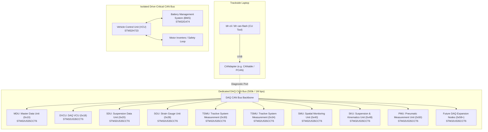
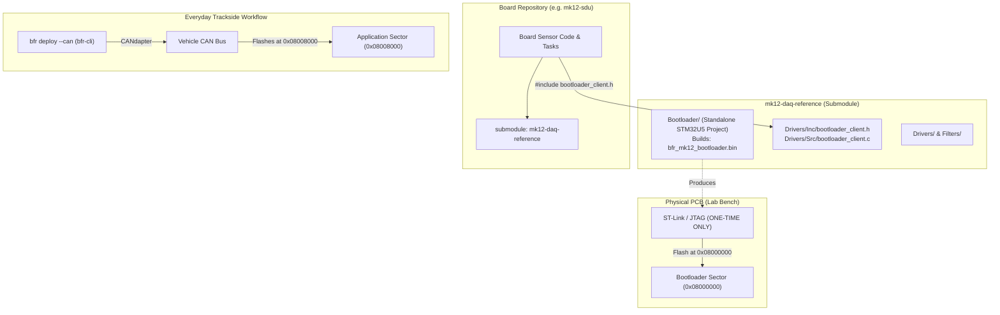
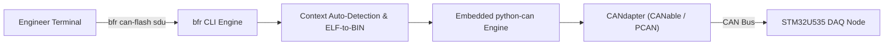
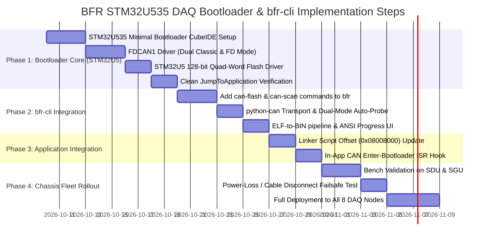

# BFR Mk. 12 DAQ Network: CAN Bootloader Implementation Plan

**Target Ecosystem**: Bruin Formula Racing (UCLA Formula SAE) — Mk. 12 Vehicle  
**Target Subsystem**: Distributed DAQ CAN Network (8+ Boards across chassis)  
**Microcontroller Target**: 100% Homogeneous **STM32U535CCT6** (ARM Cortex-M33, 160 MHz, LQFP48)  
**Host Interface**: USB CAN Adapter ("CANdapter": CANable / candleLight, PEAK PCAN-USB, Kvaser, etc.)  

---

## 1. Physical & Network Topology

### 1.1 In-Chassis Distribution & The Need for CAN Bootloading
As shown in the vehicle chassis CAD packaging layout, the DAQ boards are distributed throughout the tubular spaceframe:

- **Front Bulkhead & Suspension**: **SDUs** (Suspension Data Units) and **SGUs** (Strain Gauge Units) mounted directly near front suspension wishbones and uprights.
- **Sidepods & Powertrain**: **TSMU** (Tractive System Measurement Unit) units located in sidepods alongside cooling and high-voltage tractive enclosures.
- **Cockpit / Center Hoop**: **MDU** (Master Data Unit) and **DVCU** (DAQ VCU).
- **Rear Subframe & Kinematics**: **SKU** (Suspension & Kinematics Unit), **PMU** (Pneumatic Measurement Unit), and rear **SMU** (Spatial Monitoring Unit).

Once the carbon fiber aeroshell, nosecone, belly pan, and seat are installed, **accessing physical SWD/JTAG headers or USB ports requires hours of teardown**. A central CAN diagnostic port accessible from the sidepod or cockpit allows the entire vehicle fleet to be updated in seconds trackside.

### 1.2 Dual CAN Bus Architecture



> [!TIP]
> **Key Architectural Takeaways**:
> 1. **Complete Fleet Homogeneity**: Every single DAQ board standardizes on the **STM32U535CCT6**. We develop, validate, and maintain **one single bootloader binary**.
> 2. **Bus Isolation**: The high-traffic DAQ logging and flashing operations are physically isolated from the **Drive-Critical CAN Bus**, protecting vehicle safety loops and tractive control.

---

## 2. STM32U535CCT6 Hardware Specifications & Impact

The transition to the **STM32U535CCT6** introduces specific silicon characteristics that dictate our flash memory layout and programming algorithms:

| Specification Parameter | STM32U535CCT6 Value | Bootloader Design Impact |
| :--- | :--- | :--- |
| **Core Architecture** | ARM Cortex-M33 (up to 160 MHz) with TrustZone & FPU | Fast execution, native hardware CRC32, vector table offset `SCB->VTOR`. |
| **Flash Memory Size** | **256 KB** (`0x08000000` to `0x0803FFFF`) | Total budget for both Bootloader and Application. |
| **Erase Granularity (Page Size)** | **8 KB per page** (32 total pages: Page 0..31) | Bootloader boundary must be aligned to an **8 KB page boundary** (16 KB or 32 KB). |
| **Write Granularity** | **128-bit Quad-Word (16 bytes)** | Flash programming must write 16-byte aligned chunks using `FLASH_TYPEPROGRAM_QUADWORD`. |
| **SRAM Size** | **274 KB** (SRAM1, SRAM2, SRAM3, SRAM4) | Plentiful RAM for 4 KB streaming buffers and zero-heap execution. |
| **FDCAN Peripheral** | Bosch FDCAN1 (up to 64-byte payload / 8 Mbps BRS) | Runs standard 11-bit Classic CAN frames (8 bytes) or CAN-FD frames. |

---

## 3. Flash Memory Partitioning (256 KB Total)

Because the STM32U535 uses **8 KB pages**, partition boundaries must align to multiples of 8 KB.

```
0x08000000 +---------------------------------------------------------------+
           |  BOOTLOADER (32 KB = 4 Pages, Pages 0 to 3)                   |
           |  - Reset vector & startup                                     |
           |  - Minimal FDCAN1 driver                                      |
           |  - Flash 128-bit Quad-Word programming engine                |
           |  - Hardware CRC32 verification engine                         |
           |  - Jump-to-Application logic                                  |
0x08008000 +---------------------------------------------------------------+
           |  APPLICATION FIRMWARE (224 KB = 28 Pages, Pages 4 to 31)      |
           |  - Application Vector Table (SCB->VTOR = 0x08008000)          |
           |  - Board DAQ Firmware (MDU, SDU, SKU, SGU, etc.)             |
           |  - FreeRTOS, sensor drivers, CAN telemetry engine             |
0x08040000 +---------------------------------------------------------------+ (256 KB End)
```

### Partition Sizing Justification
- **Bootloader: 32 KB (Pages 0–3, `0x08000000`–`0x08007FFF`)**:
  - A bare-metal STM32U5 FDCAN bootloader compiles to **~10–14 KB**. Allocating 4 pages (32 KB) gives comfortable headroom and clean alignment.
- **Application: 224 KB (Pages 4–31, `0x08008000`–`0x0803FFFF`)**:
  - 224 KB is more than sufficient for high-speed DAQ sampling, FreeRTOS tasks, and filter stacks.

### Required Changes to Application Firmware

#### 1. Application Linker Script (`STM32U535xx_FLASH.ld`)
```diff
MEMORY
{
-  FLASH (rx)      : ORIGIN = 0x08000000, LENGTH = 256K
+  FLASH (rx)      : ORIGIN = 0x08008000, LENGTH = 224K
   RAM (xrw)       : ORIGIN = 0x20000000, LENGTH = 274K
}
```

#### 2. Vector Table Relocation
In the application's `main()` or early in `SystemInit()`:
```c
/* Relocate Vector Table to Application Base in STM32U5 */
SCB->VTOR = 0x08008000U;
__DSB();
__ISB();
```

---

## 4. Board Roster & Node ID Addressing Scheme

CAN IDs use a functional addressing block reserving IDs `0x700` through `0x7FF` for bootloader operations:
- **Host $\to$ Target Request ID**: `0x700 + NodeID`
- **Target $\to$ Host Response ID**: `0x780 + NodeID`
- **Broadcast Request ID**: `0x700` (Listened to by all nodes)

### Mk. 12 DAQ Node Map

| Board Acronym | Full System Name | Primary Sensor / Role | Assigned Node ID | Request CAN ID | Response CAN ID |
| :--- | :--- | :--- | :--- | :--- | :--- |
| **Broadcast** | All DAQ Nodes | Fleet-wide Ping / Force Boot | `0x00` | `0x700` | — |
| **MDU** | Master Data Unit | Central logger, VectorNav INS, SD/Telemetry | `0x10` | `0x710` | `0x790` |
| **DVCU** | DAQ Vehicle Control Unit | Cockpit DAQ, dash/display telemetry | `0x18` | `0x718` | `0x798` |
| **SDU** | Suspension Data Unit | Damper linear pots, ride height, wheel speed | `0x20` | `0x720` | `0x7A0` |
| **SGU** | Strain Gauge Unit | MCP3464 24-bit ADC, wishbone load cells | `0x28` | `0x728` | `0x7A8` |
| **TSMU (Main)** | Tractive System Measurement | High-voltage/pack thermal monitoring, MLX IR | `0x30` | `0x730` | `0x7B0` |
| **TSMU (Aux)** | Tractive System Aux | Secondary pack/cooling loop sensors | `0x34` | `0x734` | `0x7B4` |
| **SMU** | Spatial Monitoring Unit | LSM6DSO 6-axis IMU, chassis dynamics | `0x40` | `0x740` | `0x7C0` |
| **SKU** | Suspension & Kinematics Unit | Rear suspension geometry & wheel travel | `0x48` | `0x748` | `0x7C8` |
| **PMU** | Pneumatic Measurement Unit | Pneumatic shifter/drag reduction pressure | `0x50` | `0x750` | `0x7D0` |
| **EXP 1..4** | Future DAQ Expansions | Additional aero/tire temperature nodes | `0x58..0x6C`| `0x758+` | `0x7D8+` |

### Board Identification Strategy
- **Universal Binary via EEPROM**: The boards incorporate an on-board [AT24C16](file:///Users/larry/mk12-daq-reference/Drivers/Inc/at24c16.h) I2C EEPROM. The board's assigned Node ID byte (e.g. `0x20` for SDU) is written once to EEPROM address `0x0000` during board bringup.
- At power-up, the bootloader reads byte `0x0000` from the EEPROM. **Result: You only compile and maintain ONE universal bootloader `.bin` for all 8+ boards.**

---

## 5. CAN Communication Protocol: Dual-Mode (Classic CAN & CAN-FD)

The bootloader supports **both Classic CAN 2.0B (8-byte payload) and CAN-FD (up to 64-byte payload with BRS)** using a single, unified state machine.

### 5.1 How the STM32U5 FDCAN Peripheral Handles Both
The STM32U5 FDCAN peripheral (Bosch M_CAN core) is initialized in **`FDCAN_FRAME_FD_BRS`** mode:
```c
hfdcan1.Init.FrameFormat = FDCAN_FRAME_FD_BRS; /* Enable CAN-FD with Bit Rate Switching */
```
Under the ISO 11898-1:2015 specification, an FDCAN controller initialized in CAN-FD mode **natively receives and arbitrates both Classic CAN 2.0B frames AND CAN-FD frames on the same wire without any dynamic reconfiguration**:
- When a frame arrives in `RxHeader`:
  - If `RxHeader.FDFormat == FDCAN_CLASSIC_CAN`, the incoming frame is standard 8-byte Classic CAN.
  - If `RxHeader.FDFormat == FDCAN_FD_CAN`, the incoming frame is high-speed 64-byte CAN-FD.
- **Dynamic Reply Mirroring**: The bootloader mirrors whichever format the host used:
  - If the host sends a Classic frame, the bootloader transmits its response with `TxHeader.FDFormat = FDCAN_CLASSIC_CAN` (8 bytes).
  - If the host sends a CAN-FD frame, the bootloader transmits its response with `TxHeader.FDFormat = FDCAN_FD_CAN` and `BitRateSwitch = FDCAN_BRS_ON` (up to 64 bytes).

### 5.2 Operating Mode Comparison

| Parameter | Mode A: Classic CAN 2.0B (Universal Baseline) | Mode B: CAN-FD with BRS (High Speed) |
| :--- | :--- | :--- |
| **CANdapter Compatibility** | **100% of all adapters** (CANable 1.0, PEAK PCAN-USB non-FD, SLCAN, etc.) | CAN-FD adapters (CANable 2.0, PEAK PCAN-USB FD, Kvaser Leaf Pro FD) |
| **Payload Per Frame** | 8 bytes (2B header + 6B data) | 64 bytes (2B header + 48B or 62B data) |
| **Bus Speed** | 1 Mbps (or 500 kbps) fixed | 1 Mbps Nominal (Arbitration) / 4–5 Mbps Data Phase |
| **Flashing Speed (180 KB App)**| **~3.5 seconds** (using 16-packet Block-ACK) | **~0.6 seconds** |
| **Quad-Word Alignment** | 16 packets $\times$ 6B = 96B = **6 Quad-Words** | 1 packet with 48B data = **3 Quad-Words** directly |

---

### 5.3 Unified Command Specification

The command opcodes and state machine are identical for both Classic CAN and CAN-FD. In CAN-FD mode, `DATA_CHUNK` simply carries a larger block of payload bytes.

| Opcode | Name | Dir | Classic Payload (8 Bytes) | CAN-FD Payload (64 Bytes) | Description |
| :--- | :--- | :--- | :--- | :--- | :--- |
| `0x01` | `PING` | Host $\to$ Node | `[0x01, 0x00, 0x00, ...]` | `[0x01, 0x00, 0x00, ...]` | Queries node status & capabilities. |
| `0x81` | `PING_ACK` | Node $\to$ Host | `[0x81, Status, BL_Ver, NodeID, AppValid, ModesSupported, ...]` | Node replies with version and supported modes. |
| `0x02` | `ENTER_BL` | Host $\to$ Node | `[0x02, 0xDE, 0xAD, 0xBE, 0xEF, 0x00, 0x00, 0x00]` | Forces running app into bootloader. |
| `0x03` | `ERASE_APP` | Host $\to$ Node | `[0x03, 0x00, StartPage(2B), PageCount(2B), 0x00, 0x00]` | Erases 8 KB pages (Pages 4..31). |
| `0x83` | `ERASE_ACK`| Node $\to$ Host | `[0x83, Status (0=OK), ErasedPages(2B), 0x00, ...]` | Confirmation of erase completion. |
| `0x04` | `INIT_DOWNLOAD`| Host $\to$ Node | `[0x04, 0x00, TotalBytes (4B MSB), ExpectedCRC32 (2B MSB)]` | Initializes transfer parameters. |
| `0x05` | `DATA_CHUNK`| Host $\to$ Node | `[0x05, SeqNum, B0..B5]` (6B data) | `[0x05, SeqNum, B0..B47]` (48B = 3 Quad-Words) | Transfers firmware payload. |
| `0x85` | `BLOCK_ACK` | Node $\to$ Host | `[0x85, Status (0=OK), LastSeqNum, 0x00, ...]` (every 16 chunks) | `[0x85, Status (0=OK), LastSeqNum, 0x00, ...]` (every 8 chunks) | Block flow control acknowledgement. |
| `0x06` | `VERIFY_CRC`| Host $\to$ Node | `[0x06, 0x00, ExpectedCRC32 (4B MSB), 0x00, 0x00]` | Triggers target hardware CRC32 check. |
| `0x86` | `VERIFY_ACK`| Node $\to$ Host | `[0x86, Status (0=Match), TargetCRC32 (4B MSB), 0x00]` | Confirms data integrity. |
| `0x07` | `JUMP_APP` | Host $\to$ Node | `[0x07, 0x00, 0x00, 0x00, 0x00, 0x00, 0x00, 0x00]` | Triggers clean jump to application. |

### 5.4 128-Bit Quad-Word Write Alignment
On the STM32U5, flash programming requires writing **128-bit quad-words (16 bytes)** at a time:
- **In Classic CAN Mode**: The bootloader buffers 16 CAN frames $\times$ 6 payload bytes = **96 bytes**. Since $96 / 16 = 6\text{ Quad-Words}$, it commits all 6 quad-words at once.
- **In CAN-FD Mode**: Each CAN-FD frame carries **48 bytes of payload** (3 Quad-Words). The bootloader commits each frame's payload directly to Flash via 3 sequential `HAL_FLASH_Program(FLASH_TYPEPROGRAM_QUADWORD, ...)` calls.
- **Result**: Zero byte padding or alignment fragmentation in both modes!

---

## 6. STM32U535 Clean Jump-to-Application Sequence

```c
typedef void (*pFunction)(void);

void JumpToApplication(uint32_t app_address) {
    uint32_t app_stack = *(volatile uint32_t*)app_address;
    uint32_t app_entry = *(volatile uint32_t*)(app_address + 4U);

    /* 1. Sanity check Stack Pointer (must reside within STM32U535 SRAM range) */
    if ((app_stack < 0x20000000U) || (app_stack > 0x20045000U)) {
        return; /* Invalid stack pointer - do not jump */
    }

    /* 2. Disable global interrupts */
    __disable_irq();

    /* 3. Disable SysTick timer and clear count flag */
    SysTick->CTRL = 0U;
    SysTick->LOAD = 0U;
    SysTick->VAL  = 0U;

    /* 4. Disable and clear all pending NVIC interrupts */
    for (uint8_t i = 0; i < 8; i++) {
        NVIC->ICER[i] = 0xFFFFFFFFU;
        NVIC->ICPR[i] = 0xFFFFFFFFU;
    }

    /* 5. De-initialize FDCAN1 and reset RCC clock configuration */
    HAL_FDCAN_DeInit(&hfdcan1);
    HAL_RCC_DeInit();

    /* 6. Relocate Vector Table to Application Base (0x08008000) */
    SCB->VTOR = app_address;
    __DSB();
    __ISB();

    /* 7. Set Main Stack Pointer (MSP) and jump to application entry point */
    __set_MSP(app_stack);
    
    pFunction app_reset_handler = (pFunction)app_entry;
    app_reset_handler();
}
```

---

## 7. Submodule Architecture & Board Developer Workflow

A common point of confusion in bootloader development is: **Do board engineers have to build or port the bootloader into their individual projects?**
The answer is **NO**. 

Firmware on an embedded ECU consists of two completely independent programs:
1. **The Bootloader Program**: Resides at `0x08000000`–`0x08007FFF` (32 KB). Compiled **once** from `mk12-daq-reference/Bootloader/` and flashed to the MCU **once** via ST-Link/JTAG during initial PCB bringup.
2. **The Application Program**: Resides at `0x08008000`–`0x0803FFFF` (224 KB). Compiled and modified continuously by engineers in their board repositories (`mk12-sdu`, `mk12-mdu`, `mk12-sgu`, etc.).



### 7.1 What `mk12-daq-reference` Provides to Board Repositories

When an engineer adds `mk12-daq-reference` as a git submodule to their board project (`git submodule add ...`), the reference repository provides:

1. **The Shared Bootloader Client Hook (`bootloader_client.h` / `bootloader_client.c`)**:
   - Board firmware only needs to listen for the CAN message `CMD_ENTER_BOOTLOADER` sent by `bfr`.
   - When received, the hook stores `0xDEADBEEF` in an uninitialized RAM word or RTC backup register and triggers `NVIC_SystemReset()`.
   - **Board engineers only add 2 lines of code to their board's CAN RX handler!**
2. **Linker Script Memory Template**:
   - A reference linker file (`STM32U535xx_FLASH_app.ld`) or 2-line edit shifting the application start address from `0x08000000` to `0x08008000`.
3. **The Pre-compiled Golden Bootloader Binary**:
   - `mk12-daq-reference/Bootloader/Release/bfr_mk12_bootloader.bin`.
   - Stored in the reference repo so electrical/firmware leads can immediately flash new PCBs during assembly without opening a separate project.

---

### 7.2 The 3-Step Engineer Lifecycle

#### Step 1: One-Time Board Bringup (In the Lab on the Bench)
*Performed ONCE when the board is first assembled and tested:*
1. Connect an ST-Link/V3 to the SWD header.
2. Flash the universal bootloader binary:
   ```bash
   STM32_Programmer_CLI -c port=SWD -w Bootloader/Release/bfr_mk12_bootloader.bin 0x08000000 -rst
   ```
3. (Optional) Write the board's assigned Node ID byte (e.g. `0x20` for SDU) to EEPROM address `0x0000`.
4. Disconnect the ST-Link and assemble the board into its waterproof enclosure. **The ST-Link header is never needed again.**

#### Step 2: Board Repository Setup (Adding Submodule Hook)
*In the board repository (e.g. `mk12-sdu`):*
1. **Submodule Check**: Ensure `mk12-daq-reference` is pulled (`git submodule update --init --recursive`).
2. **Linker Script**: Set `FLASH` origin in `STM32U535xx_FLASH.ld`:
   ```ld
   FLASH (rx) : ORIGIN = 0x08008000, LENGTH = 224K
   ```
3. **CAN Callback Hook**: In `Core/Src/fdcan.c` or `main.c`:
   ```c
   #include "bootloader_client.h"

   void HAL_FDCAN_RxFifo0Callback(FDCAN_HandleTypeDef *hfdcan, uint32_t RxFifo0ITs) {
       FDCAN_RxHeaderTypeDef rx_header;
       uint8_t rx_data[64];
       HAL_FDCAN_GetRxMessage(hfdcan, FDCAN_RX_FIFO0, &rx_header, rx_data);

       /* Check if host is asking to enter bootloader */
       if (BootloaderClient_CheckEnterRequest(&rx_header, rx_data)) {
           BootloaderClient_EnterBootloader(); /* Stores token & resets MCU */
       }

       /* Normal application CAN handling continues below... */
   }
   ```
4. **Vector Table**: In `main()` before interrupts are enabled:
   ```c
   SCB->VTOR = 0x08008000U;
   ```

#### Step 3: Everyday Development & Trackside Tuning
*The engineer never touches SWD, JTAG, or USB again:*
1. Connect the laptop via CANdapter to the car's diagnostic port.
2. Edit sensor code in `mk12-sdu/Core/Src/main.c`.
3. In terminal, run:
   ```bash
   bfr deploy --can
   ```
   *`bfr` builds the application, signals the board over CAN, flashes the new binary in ~2 seconds, verifies CRC, and restarts the application!*

---

## 8. Host Tooling: BFR Firmware CLI (`bfr-cli`) Integration

Rather than requiring engineers to run a separate, disconnected Python script, CAN flashing will be integrated directly into the team's official **[`bfr`](file:///Users/larry/bfr-cli/bfr)** command-line tool ([`bfr-cli`](file:///Users/larry/bfr-cli)).



### 7.1 New CLI Actions & Subcommands in `bfr`

| Command | Action Description | Example Usage |
| :--- | :--- | :--- |
| `bfr can-flash [board] [id]` | Flashes compiled binary to target node over CAN | `bfr can-flash sdu` or `bfr can-flash sdu rr` |
| `bfr deploy [board] --can` | Cleans, compiles, and flashes over CAN in one step | `bfr deploy sdu --can` |
| `bfr can-scan` | Broadcasts ping to DAQ CAN bus and prints live node table | `bfr can-scan` |
| `bfr can-boot [board]` | Sends `ENTER_BOOTLOADER` frame to force node into bootloader | `bfr can-boot mdu` |
| `bfr can-jump [board]` | Sends `JUMP_APP` frame to start application on target node | `bfr can-jump mdu` |

### 7.2 Native `bfr` Features Leveraged for CAN Flashing

1. **Context-Aware Target Resolution**:
   - Running `bfr can-flash` inside `~/mk12-sdu` automatically detects target `sdu` and maps to Node ID `0x20` without typing the board name.
2. **Automatic ELF to BIN Conversion**:
   - `bfr` already discovers the compiled ELF at `<board>/Debug/<board>.elf`.
   - Before transmission, `bfr` automatically invokes `arm-none-eabi-objcopy -O binary` (using its dynamic toolchain discovery) to generate a temporary `.bin` image, extracts program boundaries, and computes the CRC32.
3. **Instance Overrides (`board_id`)**:
   - For multi-instance boards (e.g. SDU Front vs Rear, or TSMU Left vs Right), `bfr can-flash sdu fl` dynamically maps to the specific instance's CAN Node ID.
4. **Transport Layer (`python-can` embedded)**:
   - Uses `python-can` with zero external dependencies beyond standard team Python setup.
   - **Hardware Auto-Detection**:
     - **macOS**: Auto-detects serial USB-CAN devices (`candlelight` / `slcan` / `canable`) or PEAK PCAN-USB.
     - **Linux**: Defaults to `socketcan` (`can0`).
     - **Windows**: Defaults to `pcan` or COM port.
   - Can be overridden via CLI flags: `bfr can-flash sdu --interface socketcan --channel can0`.
5. **Dual-Mode Auto-Negotiation**:
   - When running `bfr can-flash`, the tool probes with a 64-byte CAN-FD `PING` first:
     - If the adapter/node supports CAN-FD, it streams at high speed (4–5 Mbps BRS, ~0.6s flash time).
     - If the adapter is a Classic-only CANable or basic USB-CAN, it seamlessly falls back to Classic 8-byte frames (~3.5s flash time).
6. **Rich ANSI Terminal Output**:
   - Maintains the team's visual aesthetic with live progress bars, transfer bitrate (KB/s), elapsed time, and CRC status.

---

## 8. Reference Repository Driver Migration to STM32U5

With the transition from STM32L5 to STM32U5, the reference repository (`mk12-daq-reference`) should be adapted to maintain full compatibility:

1. **Header Abstraction**:
   - [`Drivers/Inc/mcp3464.h:L4`](file:///Users/larry/mk12-daq-reference/Drivers/Inc/mcp3464.h#L4) and [`Drivers/Inc/at24c16.h:L28`](file:///Users/larry/mk12-daq-reference/Drivers/Inc/at24c16.h#L28) currently include `"stm32l5xx_hal.h"`.
   - Update both to `#include "main.h"`, making them automatically adapt to `stm32u5xx_hal.h` on STM32U5 projects.
2. **Handle Injection**:
   - Update [`Drivers/Src/mlx90614.c`](file:///Users/larry/mk12-daq-reference/Drivers/Src/mlx90614.c) and [`Drivers/Src/sh1106.c`](file:///Users/larry/mk12-daq-reference/Drivers/Src/sh1106.c) to take `I2C_HandleTypeDef*` in their init functions rather than hardcoding `hi2c4` and `hi2c2`.

---

## 9. Implementation Steps & Verification Plan



### Verification Checklist
1. **bfr-cli Workflow**: Run `bfr deploy sdu --can` from within `~/mk12-sdu`. Verify it builds the ELF, converts to BIN, pings the SDU over CAN, flashes, and jumps to application in one command.
2. **Dual-Mode Adapter Test**: Test `bfr can-flash` using both a Classic CANable 1.0 (8-byte frames) and a CAN-FD adapter (CANable 2.0 / PCAN-FD); verify auto-negotiation works seamlessly.
3. **128-Bit Quad-Word Flash Timing**: Validate `HAL_FLASH_Program(FLASH_TYPEPROGRAM_QUADWORD, ...)` write speeds with 8 KB page erases.
4. **Power-Cut Failsafe**: Interrupt power at 25%, 50%, and 75% flash progress. Confirm node powers back up in bootloader mode, responds to `bfr can-scan`, and accepts re-flashing.
5. **Universal Binary Validation**: Burn node IDs into AT24C16 EEPROM on two separate boards; flash the identical bootloader `.bin` to both, and confirm `bfr can-scan` identifies them independently.
